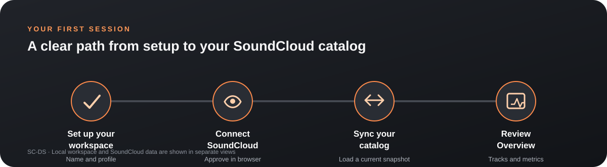
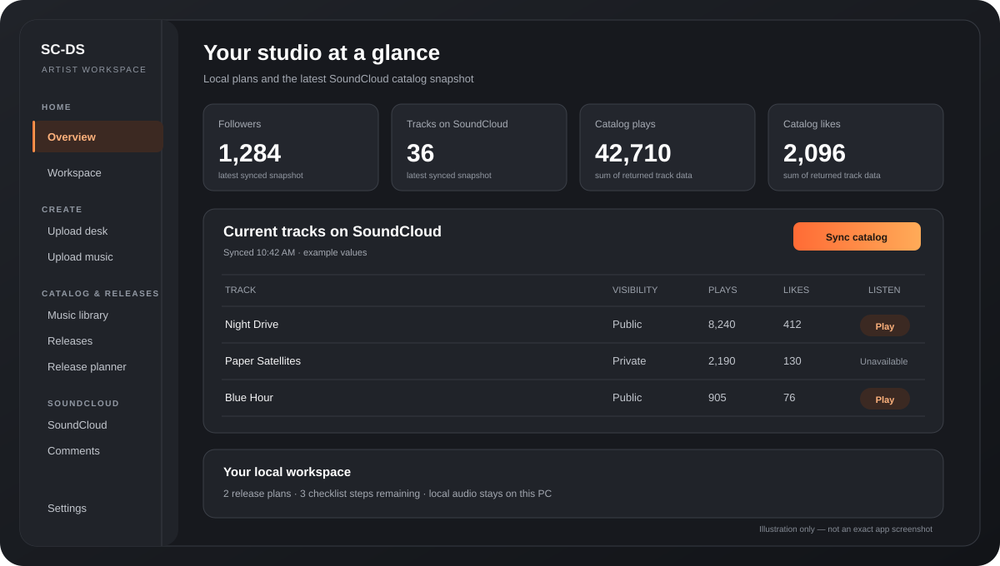
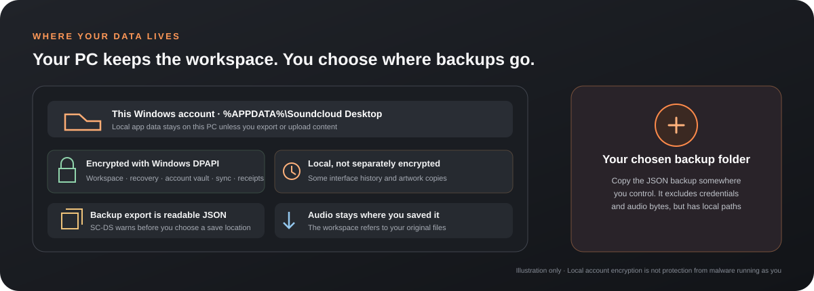

# SC-DS User Guide

**Version 1.0.0 · Windows 10 and 11**

SC-DS helps you organize music on this PC, prepare releases, and work with the SoundCloud account you connect. Your local music library and your online SoundCloud catalog are separate. Importing a file does not upload it; uploading is always a separate action.

*Illustration: the usual first-use path. It is a guide diagram, not a screenshot.*

## Start here

1. Install SC-DS with **SC-DS Installation Manager**. Read the one-time consent page, which covers privacy, SoundCloud services, copyright and DMCA responsibilities, and included third-party software. Continue only if you understand and accept it.
2. On first launch, enter an artist or studio name. Genre, location, and bio are optional. Your profile is saved on this PC.
3. To view online tracks, connect your SoundCloud account and select **Sync catalog**.
4. Open **Overview** to see the latest SoundCloud snapshot and your local workspace summary.
5. To upload a track, first add its audio file to **Music library**, then review and submit it from **Upload music** or **Upload desk**.

## Find your way around

Use the left navigation to move between these areas:

| Area | What it is for |
| --- | --- |
| **Overview** | Your workspace summary, release reminders, SoundCloud snapshot, and current tracks. |
| **Upload desk** and **Upload music** | Prepare drafts, review metadata, and upload audio to SoundCloud. |
| **Music library** | Organize and play audio files from this PC. |
| **Releases** and **Release planner** | Plan singles, EPs, albums, checklists, dates, and tasks. |
| **Promotion** and **Promotion tools** | Draft campaign copy, organize links and contacts, and track follow-ups locally. |
| **SoundCloud** and **Comments** | Connect and sync an account, review catalog and activity, and request comments for a selected track. |
| **Settings** | Edit your artist profile, manage backups, review health, privacy, and update options. |

The **Workspace** page gives another view of your next steps. Use the command palette with **Ctrl+K** to search pages and actions. On **Help & connection**, type **/** outside a text field to focus help search.

## Set up your artist profile

The first-use form asks for an artist or studio name. To edit it later, open **Settings** and update any of these fields:

- Artist or studio name
- Primary genre and location
- Tagline and short bio
- SoundCloud profile link and website
- Appearance: dark, light, or system theme

The preview shows how your details fit together. **Copy artist bio** copies formatted text to the clipboard; it does not publish or change your SoundCloud profile. Profile details are part of your local workspace and workspace backup.

## Connect SoundCloud

SC-DS uses credentials from your own SoundCloud API application. Keep the Client secret private.

1. Open **SoundCloud** and find **Connection setup**.
2. Register or open your API application using SoundCloud's [API app registration instructions](https://developers.soundcloud.com/docs/api/register-app). Follow SoundCloud's current account requirements.
3. Set its redirect URI to exactly:

   `http://127.0.0.1:49832/callback`

4. Enter the app's **Client ID** and **Client secret** in SC-DS, then select **Save credentials**.
5. Select **Connect with SoundCloud**. Sign in to the intended account in your browser and approve access.
6. Return to SC-DS and select **Sync catalog** if it does not start automatically.

Credentials and tokens are encrypted for your Windows account. SC-DS does not import browser cookies or passwords. Multiple saved accounts can be switched from the SoundCloud page; each connection is checked against its SoundCloud identity. Finish an upload, sync, or authorization before switching or removing an account.

If SC-DS says the authorization request is already open, use **Alt+Tab** or the taskbar to find the browser window and finish the existing SoundCloud request. Do not start another request while it is pending. If the page is gone, wait up to five minutes for the request to expire, then try again.

## Read Overview and your SoundCloud catalog

*Illustration: Overview content after a successful sync. Values and layout are examples, not live account data.*

After connecting and syncing, **Overview** can show:

- Account followers and SoundCloud track totals
- Plays and likes summed from tracks returned by the last sync
- Public and private track counts, plus the most-played tracks in that snapshot
- Up to five current SoundCloud tracks with visibility, plays, likes, and a **Play** button when SoundCloud marks a track streamable
- A local workspace summary, upcoming release plans, and open checklist steps

Use **Sync catalog** to request a fresh snapshot or **View full catalog** to open **SoundCloud**. The full catalog is paged and supports search, sorting, visibility filters, optional columns, grouping, saved filters, and multi-selection. You can customize Overview cards; these view preferences are saved on this PC.

The catalog is a snapshot, not a live feed. Counts reflect the API data returned by the last successful sync. A preview is available only when the current synced track record says it is streamable. Preview playback uses SoundCloud's preview route and stops when you switch or disconnect the active account. Open **Artist Insights** for SoundCloud's detailed analytics.

### Other SoundCloud views

- **SoundCloud feed:** select **Refresh feed** to request a read-only snapshot of recent activity. Filter the returned items and select **Open** to visit an item on SoundCloud. Results remain in memory for the session. This feed does not include private messages or SoundCloud Team announcements.
- **Recent tracks from artists you follow:** select **Load recent tracks** or **Refresh** to request up to 25 tracks. Results are read-only, stay in memory for the session, and are not saved to the workspace.
- **Comments:** select a track from the active account's last synced catalog and choose **Load comments**. Each request loads up to 100 comments. Search by comment text or listener name, filter timed or general comments, and use **Open track** to visit SoundCloud. Additional pages are not fetched automatically.
- **Performance milestones & digest:** set follower, track, plays, or likes thresholds. Thresholds are checked after a manual sync. **Export recent digest (CSV)** saves timestamped snapshots and differences between adjacent saved syncs.
- **Catalog history:** compare saved sync snapshots to review additions, removals, title or visibility changes, and observed count differences.

These are API snapshots, not real-time or scheduled analytics. They do not establish when a change happened between syncs. SoundCloud's public API does not provide Team messages or remote processing status in this release.

## Import and organize audio on this PC

1. Open **Music library** and choose **Import tracks**, or drag audio files into the workspace.
2. SC-DS accepts MP3, WAV, FLAC, OGG, M4A, AAC, and AIFF file extensions.
3. Search by title, genre, or notes. Filter by Draft, Mixing, Mastered, or Released.
4. Play a track, edit its workspace details, or reveal the original file in Explorer.

Importing adds a reference to the original audio; it does not move, duplicate, upload, or publish it. Playback depends on Chromium's support for the file's codec. New imports can be compared by exact file hash to detect byte-for-byte duplicates. This does not detect re-encoded copies, and existing records are not all re-read and hashed in bulk.

**Upload desk** adds a draft queue, reusable upload presets and metadata templates, preflight review, batch library editing, duplicate warnings, and local reminders. Reminders are for your own planning; they do not schedule publication on SoundCloud.

## Prepare and upload music

1. Connect the SoundCloud account that should receive the track.
2. From **Upload music** or **Upload desk**, choose a track in the local Music library.
3. Review the title, artist, genre, description and credits, artwork, and visibility. Upload desk provides a preflight review before you start.
4. Keep **Private** if the track should not be public. Choose **Public** only if you intend anyone to be able to find and listen to it.
5. To prepare now and upload later, save it to the **draft queue**. Otherwise choose **Upload now** or **Upload track**, review the confirmation, and submit.

Uploads stream from the selected original audio file. The app reports transfer progress and can cancel an active transfer. SoundCloud may continue processing after accepting the upload; SC-DS does not report remote processing status. An upload receipt records the local result, but it cannot guarantee that SoundCloud will never create a duplicate.

If the app closes during an upload or the result is unclear, open **Upload desk** and review the attempt before trying again. Check your SoundCloud catalog first. Use **I checked SoundCloud** only after checking for the track. Clearing an unknown attempt does not cancel or remove anything on SoundCloud. Public uploads may be visible to everyone. Upload only content you own or have permission to use; SC-DS does not provide legal advice or protection from copyright claims.

When SC-DS is hidden, Windows notifications may report upload or sync results. Notification text is general and does not include track titles or account details. Windows notification settings determine whether desktop alerts appear.

## Plan releases and promotion

### Releases

Use **Releases** for release cards and checklists. Use **Release planner** for a board, calendar, templates, task owners, due dates, artwork, and release readiness details.

- Plan a single, EP, or album.
- Link a track from your local Music library.
- Add artwork and edit the release details.
- Check off tasks, assign owners, and add due dates in the planner.
- Copy a release brief when you need a summary outside the app.

Dates, checklists, and readiness indicators are local planning aids. They do not schedule or publish anything on SoundCloud.

### Promotion

Use **Promotion** to save campaign drafts, captions, channels, dates, contacts, and links. **Promotion tools** adds reusable announcement and pitch templates, organized campaign links, contact notes, and follow-up dates. Copy text when you are ready to use it elsewhere. SC-DS does not send messages or collect link-click analytics.

## Save, restore, and protect your data

*Illustration: simplified local data map. Audio stays at its original location; backup exports are readable files.*

Your workspace, recovery history, SoundCloud account vault, sync checkpoints, and upload receipts are stored under `%APPDATA%\Soundcloud Desktop` and encrypted for your Windows account through Windows DPAPI. Settings reports whether workspace and recovery encryption is active. Some interface preferences and history, plus artwork copies, are not separately encrypted by SC-DS. Audio remains in its original folders.

### Export a workspace backup

Open **Settings** and select **Export workspace backup**. Before choosing a save location, SC-DS explains that the exported JSON is readable and not encrypted. It includes workspace details and local file paths; it excludes SoundCloud credentials and audio bytes. Its SHA-256 checksum can detect accidental changes or corruption, but it is not a signature and does not prove who created the file. Keep backups somewhere you control.

### Restore a backup or recovery point

Choose **Restore a backup** in Settings to select a JSON backup. Review the change preview and confirm before replacement. SC-DS saves the current workspace first. Backups contain references to audio and artwork, not those media files; when moving to another PC, move the source media separately.

For automatic local recovery history, choose **Review recovery points**. Inspect the timestamp, profile name, and record counts, then review the confirmation preview before restoring. SC-DS preserves the current workspace before replacement. Recovery history holds workspace metadata and file references only.

### Health and support

In **System health & support**, select **Refresh system health** to check storage and connection status. A sync checkpoint may show whether the last catalog sync completed or was interrupted. These checks report access and data status; they do not change Windows permissions.

**Export support bundle** creates an optional JSON file with app and system versions, health results, and sanitized event categories. It excludes workspace contents, credentials, account IDs, local paths, and raw error messages. Review the file before sharing it.

## Check for updates

In Settings, choose **Check GitHub for updates** when you want to check the latest stable release. SC-DS checks the fixed [Black Lion Studios GitHub repository](https://github.com/ghostventure/soundcloud-desktop), downloads the matching Windows setup only when you request it, and verifies both the GitHub release SHA-256 and a valid Black Lion Studios Authenticode signature. It repeats those checks before opening setup. You must confirm before setup opens; updates are not silently installed and are not checked in the background.

The 1.0.0 Windows release uses **SC-DS Installation Manager**. Setup opens visibly so you can review it. Installation or upgrade requires the current consent record. A valid signed installer is required for the updater to proceed.

## Keyboard and accessibility

- **Ctrl+K:** open the command palette.
- **Ctrl+F:** open Music library search.
- **Esc:** clear Music library search when it has focus.
- **Ctrl+I:** import audio.
- **Ctrl+N:** create a release plan.
- **Space:** play or pause audio when focus is outside a form control or button.
- **?:** open or close the keyboard shortcut reference.
- **Tab / Shift+Tab:** move through controls; **Enter** or **Space** activates the focused control.

Use the **Aa** display preferences control for higher contrast, compact spacing, or text scaling. Focus outlines remain visible for keyboard navigation.

## Troubleshooting

| What you see | What to try |
| --- | --- |
| Overview has no SoundCloud tracks | Open SoundCloud, connect the intended account, and select **Sync catalog**. The local Music library is separate. |
| The track list or totals look old | Select **Sync catalog** and check the last-sync time. Totals reflect the last returned snapshot. |
| SC-DS says the authorization request is already open | Find the existing SoundCloud page in your browser and finish it. If it is gone, wait up to five minutes for the request to expire before reconnecting. |
| Authorization returns without connecting | Check that the Client ID and secret belong to the same registered app and that its redirect URI is exactly `http://127.0.0.1:49832/callback`. |
| SoundCloud preview is unavailable | Sync the catalog. SoundCloud must mark the track streamable for this account and track. Otherwise use **Open track** on SoundCloud. |
| A local audio file will not play | Check that the original file still exists and that its codec is supported. Use **Reveal in Explorer** to locate it. |
| An upload result is uncertain | Do not immediately retry. Review the attempt in Upload desk and check the SoundCloud catalog first. |
| Update download or launch is blocked | The release must match its GitHub checksum and have a valid Black Lion Studios signature. If either check fails, do not run a copied installer; try again from Settings later. |
| Health reports workspace encryption needs attention | Refresh health. Preserve your data and contact the publisher with a reviewed support bundle if the condition remains. Do not delete workspace or recovery files to clear the message. |

## Product identity and related documentation

SC-DS is created and published by Black Lion Studios, which supports SoundCloud. SC-DS is currently an independent product and is not affiliated with or endorsed by SoundCloud; this relationship status may change. SoundCloud owns its platform, API, and marks.

- [Privacy, product identity, and third-party licenses](PRIVACY-AND-LICENSES.md)
- [Security and local data protection](SECURITY-1.0.0.md)
- [First-run consent details](FIRST-RUN-CONSENT.md)
- [Windows installer and runtime requirements](WINDOWS-INSTALLER.md)
- [Version 1.0.0 release notes](RELEASE-1.0.0.md)
- [Project README](../README.md)
